# Network-shape benchmark for quadruped locomotion in Isaac Lab

**Boston Dynamics Spot, flat terrain, velocity tracking, PPO (rsl_rl)**

- Eryk Pawełek, Michał Domański

---

## 1. Goal and research questions

**Goal:** recommend a network size for a quadruped locomotion policy trained with PPO.

| ID | Question | Experiment |
|---|---|---|
| Q1 | How does network **size** affect final performance and learning speed? | A (size) |
| Q2 | At a fixed parameter budget, does **depth vs. width** matter? | B (depth) |


---

## 2. Setup

| Item | Value |
|---|---|
| Simulator / framework | Isaac Sim 6.1, Isaac Lab 3.0 (manager-based workflow) |
| Task | `QuadruStand-Velocity-Flat-Spot-v0` (Spot, flat terrain, velocity-command tracking) |
| Algorithm | PPO, rsl_rl 5.5.1 (upstream hyperparameters, unchanged) |
| Parallel environments | 4096 |
| Training length | N = 1500 |
| Activation | ELU |
| Hardware | RTX5090 laptop variant |

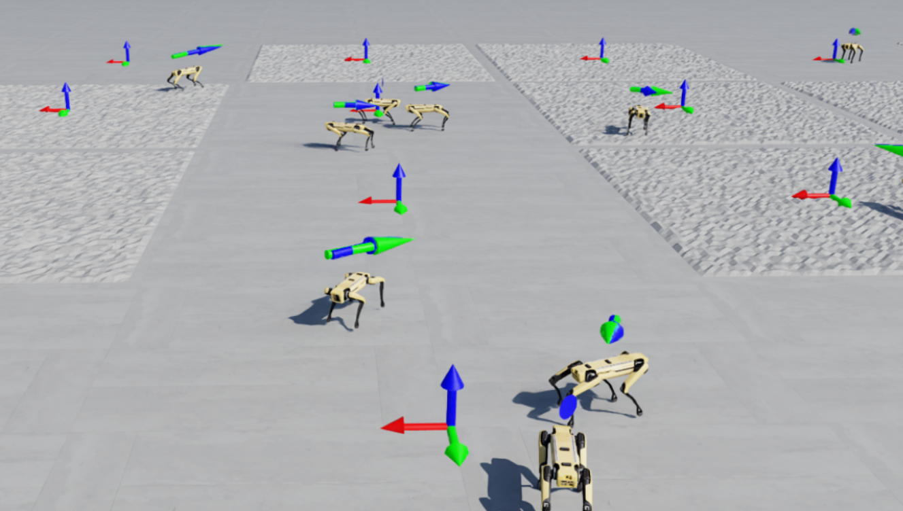


---

## 3. What the network sees and does

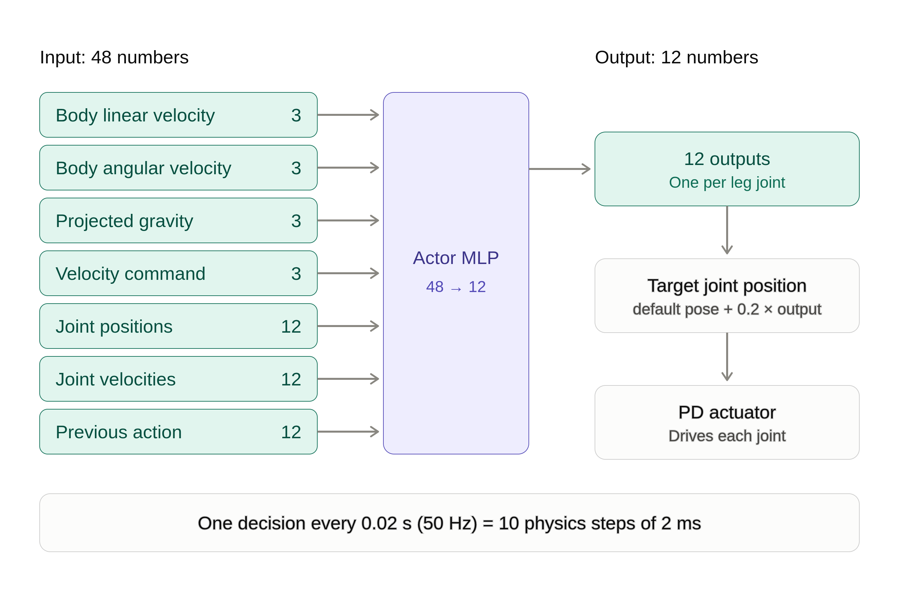

- **Input, 48 numbers:** body linear velocity (3), body angular velocity (3), projected gravity (3),
  velocity command (3), joint positions (12), joint velocities (12), previous action (12).
- **Output, 12 numbers:** one per leg joint. Target joint position = default pose + 0.2 × output, followed by a PD actuator.
- **Rate:** one decision every 0.02 s (50 Hz; 10 physics steps of 2 ms).
- Actor and critic are separate MLPs with the same hidden layers; only the actor runs on the robot.

---

## 4. Compared variants

The parameter counts are for the actor (48 inputs, 12 outputs); the critic has the same hidden layers.

**Experiment A: size** (tapering shape)

| Variant | Hidden layers | Actor params |
|---|---|---|
| extra_small | [64, 32, 16] | 6k |
| small | [128, 64, 32] | 17k |
| medium | [256, 128, 64] | 54k |
| baseline | [512, 256, 128] | 191k |
| large | [1024, 512, 256] | 709k |

**Experiment B: depth at a fixed budget (about 190k parameters)**

| Variant | Hidden layers | Actor params |
|---|---|---|
| deep_1 | [3072] | 187k |
| deep_2 | [400, 400] | 185k |
| baseline (3 layers) | [512, 256, 128] | 191k |
| deep_5 | [208, 208, 208, 208, 208] | 187k |

Only `hidden_dims` differs between runs. Everything else is inherited from Isaac Lab's Spot configuration.

---

## 5. Protocol

- **Same conditions for every run:** same task, 4096 envs, same PPO settings, same number of iterations.
- **Seeds:** baseline trained with seeds 1, 2, 3. Each other variant with seed 1 (screening).
- **Noise band:** the min–max range of a metric over the 3 baseline seeds. A variant counts as different from the
  baseline only if it falls **outside** this band.
- This is a screening rule for a limited compute budget, **not** a formal significance test.

[0.9 smoothing factor] 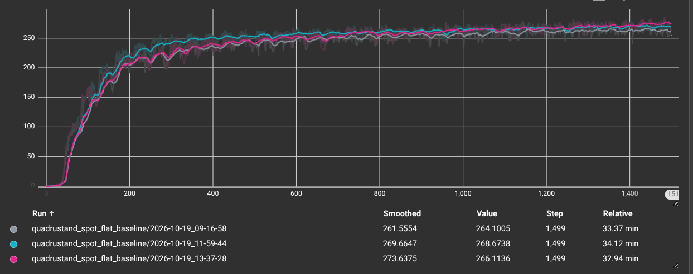

---

## 6. Metrics

**From training logs (TensorBoard):**
- Mean reward (`Train/mean_reward`)
- Velocity tracking edocs/presentationrror (`Metrics/base_velocity/error_vel_xy`, `.../error_vel_yaw`)
- Fall share (`Episode_Termination/body_contact`)
- **Learning speed:** first iteration where the smoothed reward reaches 90% of a target value
  - target 1: the run's own final reward
  - target 2: the baseline's final reward
  - final reward = mean of the last 5% of iterations; smoothing = 20-iteration moving average

**From a separate deterministic evaluation (planned):** linear velocity error, yaw rate error, tilt, fall rate,
tracking success rate. The primary metric is the **tracking success rate**.


---

## 7. Results: learning curves

 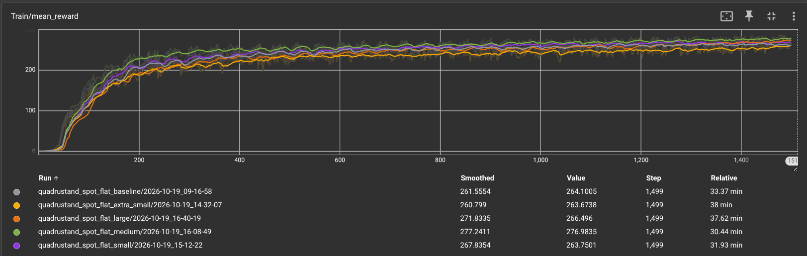

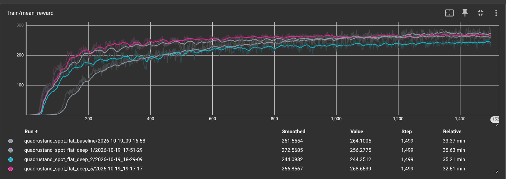

---

## 8. Results: learning speed (PRELIMINARY, 1 seed per variant)

Iterations until the smoothed reward reaches 90% of the target; **beyond noise** = distance outside the baseline noise
band (0 = inside the band, `+` = slower than the slowest baseline seed, `-` = faster than the fastest).
Source: `scripts/learning_speed.py`, window 20.

Noise band: `own_90` 275 .. 472, `baseline_90` 274 .. 438 (3 baseline seeds).

| Variant | Seed | Final reward | to 90% of own final | beyond noise | to 90% of baseline final | beyond noise |
|---|---|---|---|---|---|---|
| baseline | 1 | 264.0 | 397 | 0 | 438 | 0 |
| baseline | 2 | 269.6 | 275 | 0 | 274 | 0 |
| baseline | 3 | 274.6 | 472 | 0 | 388 | 0 |
| extra_small | 1 | 257.9 | 468 | 0 | 806 | +368 |
| small | 1 | 268.6 | 394 | 0 | 395 | 0 |
| medium | 1 | 277.6 | 317 | 0 | 272 | -2 |
| large | 1 | 270.5 | 532 | +60 | 529 | +91 |
| deep_1 | 1 | 274.8 | 829 | +357 | 757 | +319 |
| deep_2 | 1 | 244.0 | 536 | +64 | 1162 | +724 |
| deep_5 | 1 | 269.0 | 312 | 0 | 312 | 0 |

---

## 8a. Learning speed vs network size (Experiment A)

Lower = faster. Grey band = range of the 3 baseline seeds. Only points **outside** the band are labelled.

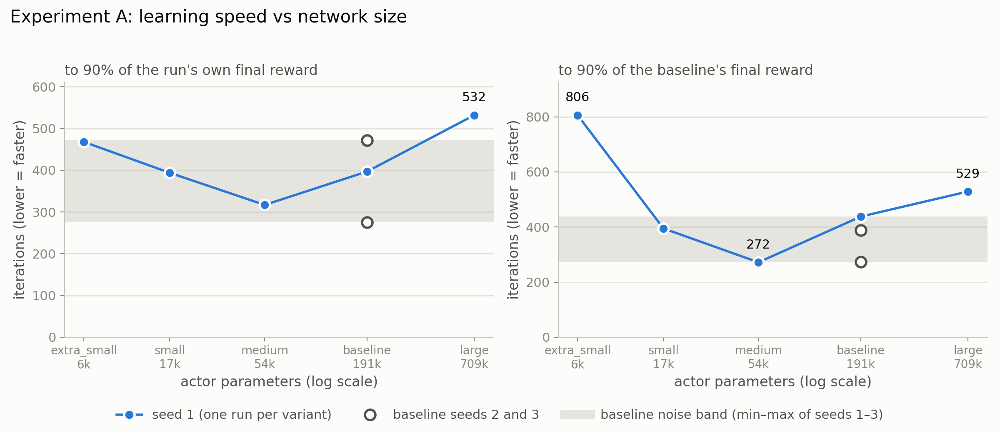

---

## 8b. Learning speed vs depth at a fixed budget (Experiment B)

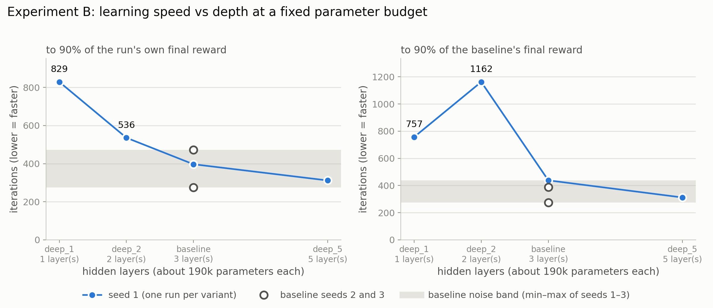

---

## 8c. Where each curve reaches the threshold

The marker on each curve is the iteration at which its smoothed reward first reaches 90% of the baseline's final reward
(the numbers in the legend are the table's last "to 90% of baseline final" column).

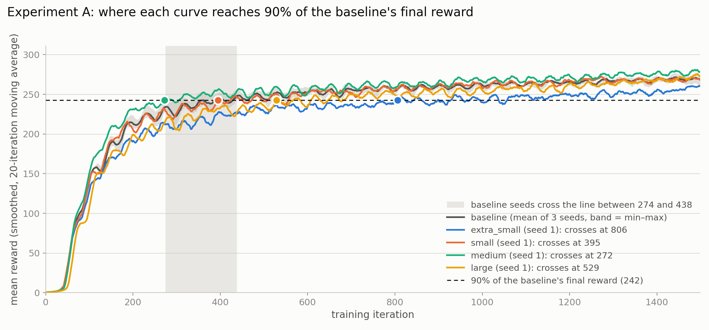

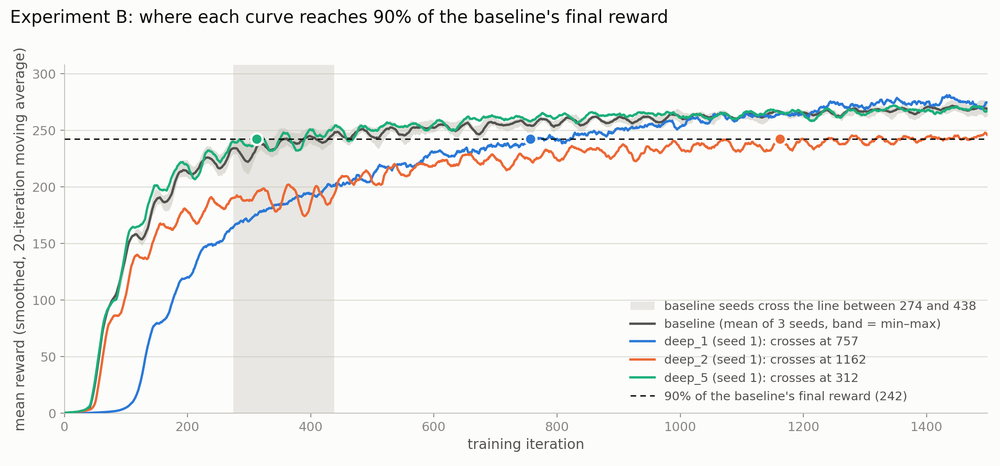

*Figures are generated by `scripts/make_learning_speed_plots.py`; rerun it after new runs.*

---

## 9. Results: evaluation of the trained policies
### 9.1. Inference script
The Evaluation of inference was carried out by running all the model checkpoints that were trained and recording following parameters:
1. **Network variant**
2. **Checkpoint of network**
3. **Seed**
4. **Number of environments running in parallel**
5. **Absolute linear velocity error**
6. **Yaw error**
7. **Mean tilt of robot**
8. **Maximal tilt of robot**
9. **Fall rate of robot across the parallel environments**

The script used to recording those parameters take into the count:
- number of parallel environments
- Amount of physical steps limit
- seed
- and few more to run the isaaclab hydra properly

The script was run with:
1. **Hard limit of 1000 physical steps**
2. **16 parallel environments**

### 9.2. Resulting data
From the aforementioned parameters the most interesting are: Linear velocity error, yaw rate error and fall rate.
The Graph below shows the mean value of Linear velocity error , mean yaw rate error and mean fall rate. It is the mean value because 16 environments are running parallel. Also the plots are limited to half of the physical steps due to the robots starting the simulation by spawning again and thus introduce noise from starting the tasks again.
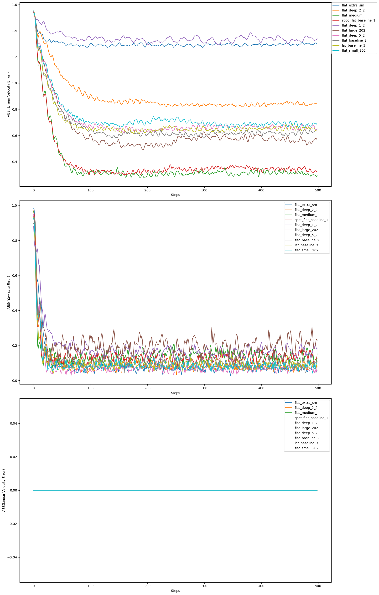
At the figure it is clearly visible that besides the diffrence in the Linear velocity there is not much of a diffrence in models in **Yaw rate** and **fall rate**. At first the fall rate might seem like a simple bug because it is just a ssingle horizontal line, but fear not. Simply all the models were trained enough not to fall. Another key factor occuring from the plot is that the key diffrence in them is the Linear Velocity.


Following scatter plot shows the **mediana of Yaw rate error** at Y axis and **mediana of Linear Velocity error** at X axis per each of the models. **So the closer the model is to point (0,0) the better it get**
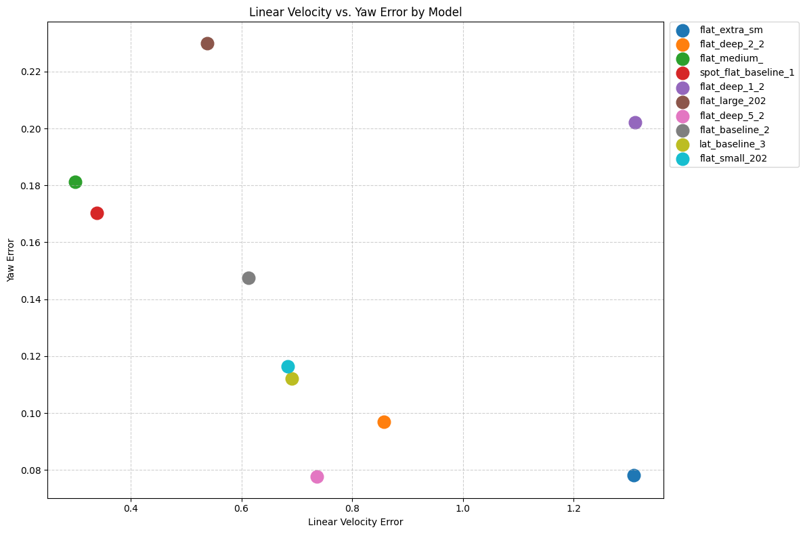

Thus for ease of assesing which model is easier the following succes score function is constructed:
### Evaluation Metric Formulation

1. **Composite Error per Run:**
   $$f(x_i, y_i) = 10x_i + 5y_i$$

2. **Maximum Observed Error:**
   $$e_{\max} = \max_{j \in \{1, \dots, N\}} f(x_j, y_j)$$

3. **Inverted Success Score:**
   $$S_i = (e_{\max} + 2) - f(x_i, y_i)$$

**Combined Form:**
$$S(x_i, y_i) = \left( \max_{j=1}^{N} (10x_j + 5y_j) + 2 \right) - (10x_i + 5y_i)$$

The weights for Linear velocity error are twice the weights for yaw rate error due to the importance of the Linear velocity error. The scores are also reversed so it is easier to check for best model as the one with most score. Below is the Bar plot with the Succes metric calculated per each of the models.

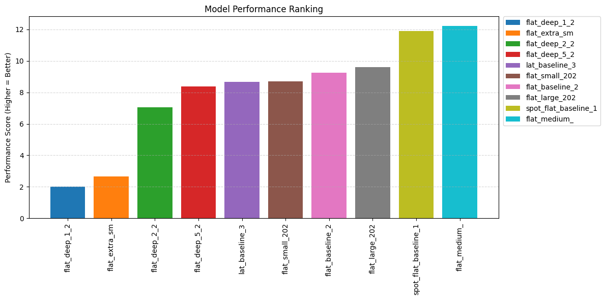

---

## 10. Conclusions

*Fill in after the final results. Each conclusion should name its evidence and its caveat.*


**Q1: network size**
- Finding: Network size matters only on the extrimes. 
Small -> to small capacity
Large -> hard to optimize

Final recomendation would be to allways start wit the medium size network.

**Q2: depth at a fixed budget**
- Finding: At fixed parameter budget, deeper networks learn faster. 
The mean reward doesn't follow that rule.

**Q3: Defining reward for agent doesnt always lead to expected result**
- even with defining many rewards for agent and thus softly constraining it to certain learning direction. One might susspect that with linear velocity error at some point it will start walking or running as it is fastest way of locomotion for such robot right? **WRONG** it started jumping.


---

## 11. Limitations

- Flat terrain only (the only Spot locomotion task in Isaac Lab 3.0)
- Most variants have a **single seed**; conclusions rest on the baseline noise band from 3 seeds.
- Training metrics include exploration noise; the definitive comparison is the deterministic evaluation.
- Simulation only; no hardware test.
- Wall-clock times are comparable only on the same machine.

---


# QuadruStand

Benchmark of neural-network architectures and hyperparameters for quadruped locomotion in Isaac Lab,
followed by a reward-shaping study in which the robot learns to stand upright on its front legs.
The long-term objective is sim-to-real transfer of the resulting policy to a physical Boston Dynamics Spot.

| | |
|---|---|
| Simulation | Isaac Sim / Isaac Lab (manager-based RL workflow, `isaaclab` CLI) |
| RL library | rsl_rl (PPO) |
| Hyperparameter optimisation | Optuna (one training run per trial, resumable study; planned, not implemented yet) |

## Status

Environment setup is complete. The first task, `QuadruStand-Velocity-Flat-Spot-v0`, is registered: it inherits
Isaac Lab's Spot flat-terrain velocity task unchanged, with eight rsl_rl agent variants that differ only in network
shape: the baseline, four sizes (`extra_small`, `small`, `medium`, `large`) and three depths at a fixed parameter budget
(`deep_1`, `deep_2`, `deep_5`). The benchmark protocol is in `docs/lab_required/BENCHMARK.md`; training runs, a
learning-speed analysis and a policy-evaluation script exist (`scripts/`). The reward-shaping study (standing on the
front legs) and the Optuna study are not implemented yet.

## Documentation

Start with `docs/README.md`: it lists every document and says which one to read for what.

## Repository layout

```
QuadruStand/
├── src/quadru_stand/           # our Python package (installed in editable mode)
│   └── tasks/
│       ├── __init__.py             #   gym.register("QuadruStand-Velocity-Flat-Spot-v0", ...) and all --agent keys
│       ├── flat_env_cfg.py         #   QuadruStandSpotFlatEnvCfg (inherits Isaac Lab's SpotFlatEnvCfg)
│       └── rsl_rl_ppo_cfg.py       #   PPO runner configs: baseline, size variants, depth variants
├── scripts/                    # command-line tools, run from the repo root
│   ├── evaluate_policy.py          #   deterministic evaluation of trained policies -> results/*.csv
│   ├── learning_speed.py           #   learning speed of every run in logs/
│   ├── make_learning_speed_plots.py#   figures for the presentation
│   └── configure_pyrefly.sh        #   editor helper (see "Editor (Pyrefly)")
├── tests/                      # registration tests (pytest)
├── notebooks/                  # exploratory analysis of the evaluation results
├── docs/                       # documentation (start at docs/README.md)
├── logs/                       # training runs (contents gitignored)
└── results/                    # evaluation CSVs (gitignored)
```

## Environment

### Reference configuration

| Component | Version |
|---|---|
| OS / hardware | Ubuntu, NVIDIA GPU with a driver supporting CUDA 13 |
| Python | 3.12 (managed by uv) |
| Isaac Lab | `release/3.0.0` |
| Isaac Sim | 6.1.0.0 (pinned by Isaac Lab) |
| PyTorch | 2.11.0 + CUDA 13.0 (`cu130`) |
| rsl-rl-lib | 5.5.1 |

### Installation

Prerequisites: `git`, `uv`, `cmake`. The Isaac Lab installer runs `sudo apt-get install cmake
build-essential` if `cmake` is not found.

```bash
# 1. Isaac Lab source checkout (any location; it must remain in place, see "Design notes")
git clone https://github.com/isaac-sim/IsaacLab.git --branch release/3.0.0 ~/tools/nvidia/IsaacLab

# 2. Project virtual environment
cd QuadruStand
uv venv --python 3.12 --seed .venv
source .venv/bin/activate

# 3. Isaac Lab, Isaac Sim, PyTorch and rsl_rl (several GB; allow 10+ minutes)
~/tools/nvidia/IsaacLab/isaaclab.sh -i 'isaacsim,rl[rsl-rl]'

# 4. This project (editable) and Optuna
uv pip install -e .

# 5. Pyrefly (Cursor language server): expose Isaac Lab source paths
./scripts/configure_pyrefly.sh
```

Then reload the Cursor window (Command Palette → **Developer: Reload Window**) so Pyrefly rereads `.venv`.

### Verification

```bash
python -c "import isaaclab, isaacsim, torch; print(torch.__version__, torch.cuda.is_available())"
# expected output: 2.11.0+cu130 True
```

The first simulator launch unpacks Isaac Sim extensions (10+ minutes) and requires accepting the
NVIDIA Omniverse EULA.

### Design notes

- **Isaac Lab is installed from a source checkout, not from PyPI.** The packages published on PyPI
  are 3.0 pre-releases with dependency pins that conflict with Isaac Sim 6.x. The release branch
  and its installer are the supported route.
- **The installer is the source of truth for dependency versions.** It reads the pins in the
  checkout's `pyproject.toml` and installs matching PyTorch (cu130), Isaac Sim and Newton builds.
  This repository's `pyproject.toml` therefore declares only the project package and Optuna.
- **Editable links.** Isaac Lab packages in `.venv` point to the checkout. Do not move or delete it.
- **Do not run `uv sync` in this repository.** It would reconcile the environment to the minimal
  `pyproject.toml` and remove Isaac Lab. Add packages with `uv pip install`.
- **Reproducibility.** After a verified installation, record the exact package set with
  `uv pip freeze > requirements.lock` and commit it.

### Editor (Pyrefly)

Cursor uses **Pyrefly** as the Python language server. `[tool.pyrefly]` in `pyproject.toml`
points it at `.venv/bin/python`, which is enough for packages that actually live in
`.venv` (`torch`, `isaacsim`, `optuna`).

Isaac Lab is different: the installer registers it with setuptools *import-hook* `.pth`
files. Python can run those hooks; Pyrefly cannot, so imports like `isaaclab.utils` look
missing even though `python -c "import isaaclab"` works.

`scripts/configure_pyrefly.sh` reads the hook mappings already in `.venv` (so it
follows *this* machine's Isaac Lab checkout) and writes a path-based
`isaaclab_editable_paths.pth` next to them. Rerun the script after reinstalling Isaac Lab
or moving the checkout. The generated file stays in `.venv` and is not committed.

If the editor still reports `Cannot find module isaaclab...`, reload the window.

## Usage

With the environment activated (`source .venv/bin/activate`), from the repo root:

```bash
isaaclab list_envs | grep QuadruStand                # confirm the task is registered
python -m pytest tests/test_registration.py -q       # registration tests

# single training run, baseline network [512, 256, 128] (default agent)
# add --viz kit to open the simulator window while it trains
isaaclab train --rl_library rsl_rl --task QuadruStand-Velocity-Flat-Spot-v0

# other networks, selected with --agent <key>
isaaclab train --rl_library rsl_rl --task QuadruStand-Velocity-Flat-Spot-v0 \
    --agent rsl_rl_small_cfg_entry_point             # [128, 64, 32]
#   --agent rsl_rl_extra_small_cfg_entry_point       # [64, 32, 16]
#   --agent rsl_rl_medium_cfg_entry_point            # [256, 128, 64]
#   --agent rsl_rl_large_cfg_entry_point             # [1024, 512, 256]
#   --agent rsl_rl_deep_1_cfg_entry_point            # [3072]
#   --agent rsl_rl_deep_2_cfg_entry_point            # [400, 400]
#   --agent rsl_rl_deep_5_cfg_entry_point            # [208, 208, 208, 208, 208]

# analysis
python scripts/learning_speed.py                     # learning speed of every run in logs/
python scripts/evaluate_policy.py                    # evaluate trained policies (starts the simulator)
```

Each agent variant logs to its own folder: `logs/rsl_rl/quadrustand_spot_flat_<variant>/<timestamp>/`.
All commands, with the exact flags and what each name means: `docs/commands.md`.
