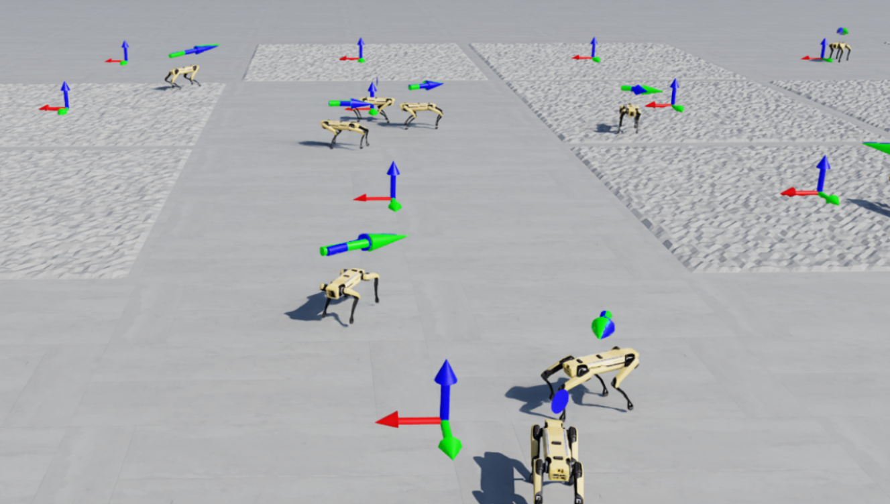
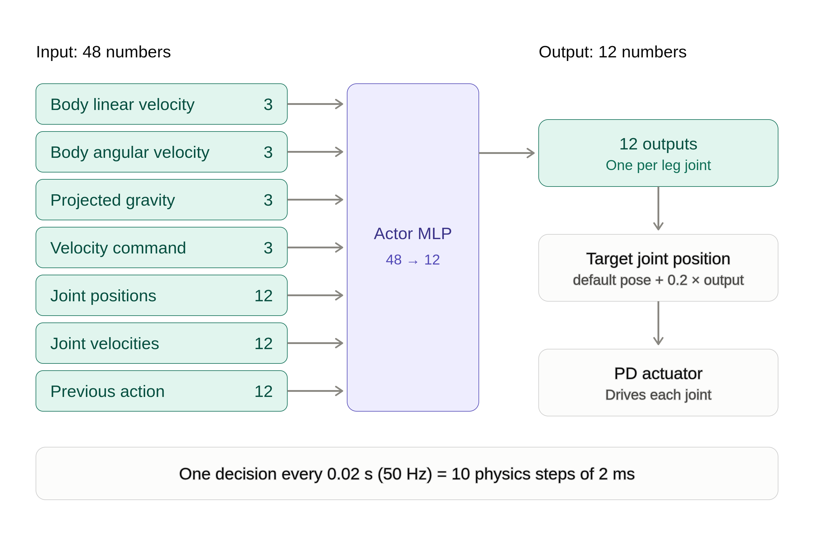
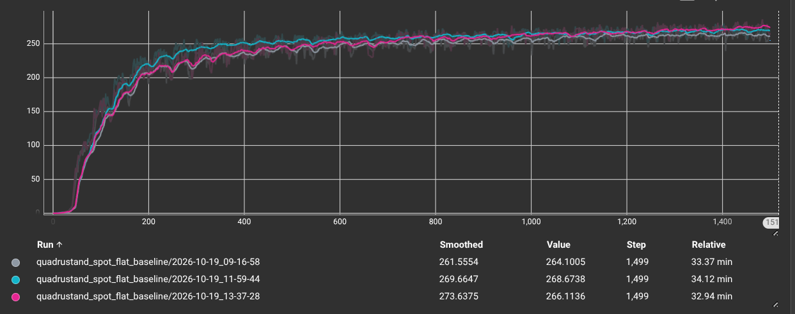

<!--
DRAFT. How to use this file:
- One slide = one section; slides are separated by a line with `---`.
- [TODO] = text you must write or confirm. [IMAGE] = a figure to drop into docs/presentation/images/ (the file name
  in the image link is the suggested name; the link renders once the file exists).
- Numbers that are already filled in come from the logs / BENCHMARK.md and are marked PRELIMINARY where only one
  seed exists. Update them after the final runs.
-->

# Network-shape benchmark for quadruped locomotion in Isaac Lab

**Boston Dynamics Spot, flat terrain, velocity tracking, PPO (rsl_rl)**

- Eryk Pawełek, Michał Domański

---

## 1. Goal and research questions

**Goal:** recommend a network size for a quadruped locomotion policy trained with PPO.

| ID | Question | Experiment |
|---|---|---|
| Q1 | How does network **size** affect final performance and learning speed? | A (size) |
| Q2 | At a fixed parameter budget, does **depth vs. width** matter? | B (depth) |


---

## 2. Setup

| Item | Value |
|---|---|
| Simulator / framework | Isaac Sim 6.1, Isaac Lab 3.0 (manager-based workflow) |
| Task | `QuadruStand-Velocity-Flat-Spot-v0` (Spot, flat terrain, velocity-command tracking) |
| Algorithm | PPO, rsl_rl 5.5.1 (upstream hyperparameters, unchanged) |
| Parallel environments | 4096 |
| Training length | N = 1500 |
| Activation | ELU |
| Hardware | RTX5090 laptop variant |




---

## 3. What the network sees and does



- **Input, 48 numbers:** body linear velocity (3), body angular velocity (3), projected gravity (3),
  velocity command (3), joint positions (12), joint velocities (12), previous action (12).
- **Output, 12 numbers:** one per leg joint. Target joint position = default pose + 0.2 × output, followed by a PD actuator.
- **Rate:** one decision every 0.02 s (50 Hz; 10 physics steps of 2 ms).
- Actor and critic are separate MLPs with the same hidden layers; only the actor runs on the robot.

---

## 4. Compared variants

The parameter counts are for the actor (48 inputs, 12 outputs); the critic has the same hidden layers.

**Experiment A: size** (tapering shape)

| Variant | Hidden layers | Actor params |
|---|---|---|
| extra_small | [64, 32, 16] | 6k |
| small | [128, 64, 32] | 17k |
| medium | [256, 128, 64] | 54k |
| baseline | [512, 256, 128] | 191k |
| large | [1024, 512, 256] | 709k |

**Experiment B: depth at a fixed budget (about 190k parameters)**

| Variant | Hidden layers | Actor params |
|---|---|---|
| deep_1 | [3072] | 187k |
| deep_2 | [400, 400] | 185k |
| baseline (3 layers) | [512, 256, 128] | 191k |
| deep_5 | [208, 208, 208, 208, 208] | 187k |

Only `hidden_dims` differs between runs. Everything else is inherited from Isaac Lab's Spot configuration.

---

## 5. Protocol

- **Same conditions for every run:** same task, 4096 envs, same PPO settings, same number of iterations.
- **Seeds:** baseline trained with seeds 1, 2, 3. Each other variant with seed 1 (screening).
- **Noise band:** the min–max range of a metric over the 3 baseline seeds. A variant counts as different from the
  baseline only if it falls **outside** this band.
- [TODO] Stage 3: variants inside the band that were re-run with seeds 2 and 3 (list them).
- This is a screening rule for a limited compute budget, **not** a formal significance test.

[0.9 smoothing factor] 

---

## 6. Metrics

**From training logs (TensorBoard):**
- Mean reward (`Train/mean_reward`)
- Velocity tracking error (`Metrics/base_velocity/error_vel_xy`, `.../error_vel_yaw`)
- Fall share (`Episode_Termination/body_contact`)
- **Learning speed:** first iteration where the smoothed reward reaches 90% of a target value
  - target 1: the run's own final reward
  - target 2: the baseline's final reward
  - final reward = mean of the last 5% of iterations; smoothing = 20-iteration moving average

**From a separate deterministic evaluation (planned):** linear velocity error, yaw rate error, tilt, fall rate,
tracking success rate. The primary metric is the **tracking success rate**.

[TODO] state clearly on the slide which of these have been measured yet (evaluation script not written at the time of this draft).

---

## 7. Results: learning curves

[IMAGE] 
*[TODO caption: Experiment A, mean reward vs iteration, baseline seeds shaded.]*

[IMAGE] 
*[TODO caption: Experiment B, mean reward vs iteration.]*

[IMAGE] 
*[TODO caption: velocity tracking error during training (includes exploration noise).]*

[IMAGE] 
*[TODO caption: share of episodes ending in a fall (body contact).]*

---

## 8. Results: learning speed (PRELIMINARY, 1 seed per variant)

Iterations until the smoothed reward reaches 90% of the target; **beyond noise** = distance outside the baseline noise
band (0 = inside the band, `+` = slower than the slowest baseline seed, `-` = faster than the fastest).
Source: `logs/learning_speed.py`, window 20.

Noise band: `own_90` 275 .. 472, `baseline_90` 274 .. 438 (3 baseline seeds).

| Variant | Seed | Final reward | to 90% of own final | beyond noise | to 90% of baseline final | beyond noise |
|---|---|---|---|---|---|---|
| baseline | 1 | 264.0 | 397 | 0 | 438 | 0 |
| baseline | 2 | 269.6 | 275 | 0 | 274 | 0 |
| baseline | 3 | 274.6 | 472 | 0 | 388 | 0 |
| extra_small | 1 | 257.9 | 468 | 0 | 806 | +368 |
| small | 1 | 268.6 | 394 | 0 | 395 | 0 |
| medium | 1 | 277.6 | 317 | 0 | 272 | -2 |
| large | 1 | 270.5 | 532 | +60 | 529 | +91 |
| deep_1 | 1 | 274.8 | 829 | +357 | 757 | +319 |
| deep_2 | 1 | 244.0 | 536 | +64 | 1162 | +724 |
| deep_5 | 1 | 269.0 | 312 | 0 | 312 | 0 |

[IMAGE] 
*[TODO caption: learning speed against actor parameter count (Experiment A).]*

[IMAGE] 
*[TODO caption: learning speed against number of layers (Experiment B).]*

---

## 9. Results: evaluation of the trained policies

[TODO: fill in once the evaluation script has run on every final checkpoint. Mean and min–max over seeds.]

| Variant | Velocity error [m/s] | Yaw error [rad/s] | Mean tilt [°] | Fall rate | Tracking success |
|---|---|---|---|---|---|
| baseline | [TODO] | [TODO] | [TODO] | [TODO] | [TODO] |
| extra_small | [TODO] | [TODO] | [TODO] | [TODO] | [TODO] |
| small | [TODO] | [TODO] | [TODO] | [TODO] | [TODO] |
| medium | [TODO] | [TODO] | [TODO] | [TODO] | [TODO] |
| large | [TODO] | [TODO] | [TODO] | [TODO] | [TODO] |
| deep_1 | [TODO] | [TODO] | [TODO] | [TODO] | [TODO] |
| deep_2 | [TODO] | [TODO] | [TODO] | [TODO] | [TODO] |
| deep_5 | [TODO] | [TODO] | [TODO] | [TODO] | [TODO] |

[IMAGE] 
*[TODO caption: tracking success rate against parameter count.]*

[IMAGE] 
*[TODO: frames or a link to a video of the best policy.]*

---

## 10. Conclusions

*Fill in after the final results. Each conclusion should name its evidence and its caveat.*

**Q1: network size**
- Finding: [TODO]
- Evidence: [TODO slide / figure / number]
- Caveat: [TODO]

*Data to look at (preliminary, 1 seed): final rewards span 244–278 across variants; the baseline seeds alone span
264–275. In the learning-speed table, `deep_1` is clearly slower and `extra_small` is slower to reach the baseline's level.
Most other differences fall inside the baseline noise band.*

**Q2: depth at a fixed budget**
- Finding: [TODO]
- Evidence: [TODO]
- Caveat: [TODO]

**Recommendation: network size for Spot flat-terrain locomotion**
- [TODO: the recommended hidden-layer configuration and why (performance vs training cost vs parameter count).]

---

## 11. Limitations

- Flat terrain only (the only Spot locomotion task in Isaac Lab 3.0); [TODO: relation to the rough-terrain plan in the project plan, agreed with the supervisor?]
- Most variants have a **single seed**; conclusions rest on the baseline noise band from 3 seeds.
- Training metrics include exploration noise; the definitive comparison is the deterministic evaluation. [TODO: status]
- Simulation only; no hardware test.
- Wall-clock times are comparable only on the same machine.
- [TODO] anything else (hyperparameters not re-tuned per network size, one task, one robot).

---

## 12. Next steps

- Reward shaping so Spot stands upright on its front legs (reward-shaping study).
- Sim-to-real: export the policy and test it on a physical Spot (observation noise is currently disabled in training;
  `base_lin_vel` needs a state estimator on the real robot).
- [TODO] anything agreed with the supervisor.

---

## Appendix A: reproduction

```bash
source .venv/bin/activate

# baseline, seed 1
isaaclab train --rl_library rsl_rl --task QuadruStand-Velocity-Flat-Spot-v0 --seed 1 --max_iterations 1500

# a variant, seed 1
isaaclab train --rl_library rsl_rl --task QuadruStand-Velocity-Flat-Spot-v0 \
    --agent rsl_rl_medium_cfg_entry_point --seed 1 --max_iterations 1500

# learning speed of every run
python logs/learning_speed.py
```

Details: `docs/lab_required/BENCHMARK.md`, `docs/notes/commands.md`.

---

## Appendix B: likely questions

- [TODO] Why PPO with an MLP? Why these sizes?
- [TODO] How were the seeds and the noise band chosen, and is 3 seeds enough?
- [TODO] What does the 0.2 action scale do, and would a different value change the result?
- [TODO] Why flat terrain, and what changes on rough terrain?
